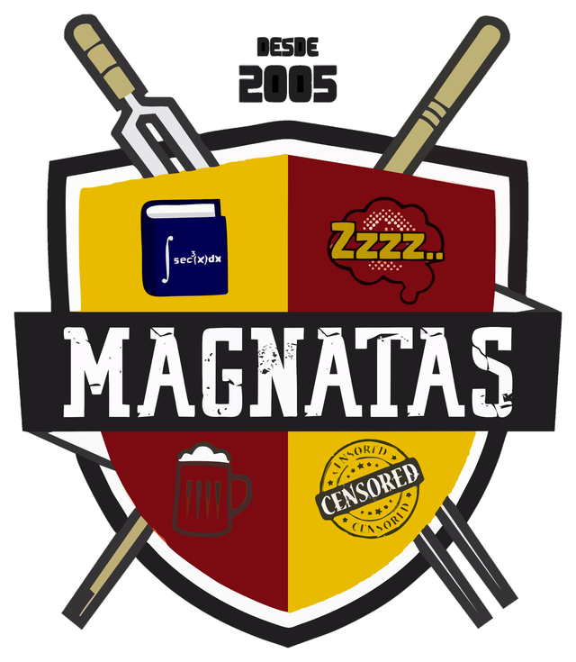
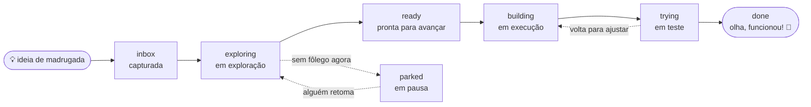

# maGbRAIN 🧠⚡

**Da ideia de madrugada ao “olha, funcionou!”**

Um cérebro coletivo. Várias mãos. Uma quantidade questionável de café.

### [🗺️ Explorar o mapa](https://pedrocamargolince.github.io/maGbRAIN/) · [💡 Registrar uma ideia](docs/templates/IDEA.md) · [🛠️ Contribuir](CONTRIBUTING.md)

Laboratório coletivo de ideias da república: capturar, desenvolver e realizar, uma contribuição de cada vez.

> **Uma sessão não precisa terminar uma ideia. O progresso pertence ao projeto, não ao chat.**

## 📊 Placar

Ninguém atualiza esses números à mão. O placar é contado a partir de [`ideas/`](ideas/), [`projects/`](projects/) e das fichas em [`contributions/`](contributions/) a cada mudança na `main`, junto com o mapa. Para aparecer nele, basta a sua entrega ter uma [ficha de crédito](docs/CONTRIBUTIONS.md).

## 🚀 Comece aqui
1. Conte sua ideia a um agente e peça que leia [AGENTS.md](AGENTS.md).
2. Registre em `ideas/<ID>-<nome>/IDEA.md`, usando o [modelo](docs/templates/IDEA.md). Duas frases bastam.
3. Para trabalhar, escolha uma tarefa pequena (as abertas a qualquer pessoa têm a etiqueta [`quero-ajuda`](https://github.com/PedroCamargoLINCE/maGbRAIN/issues?q=is%3Aissue+is%3Aopen+label%3Aquero-ajuda) e aparecem em destaque no mapa), coloque-se como responsável (Assignee) na Issue e use uma branch e PR.
4. Ao encerrar, deixe evidências e uma [passagem de trabalho](docs/templates/HANDOFF.md).

Agentes precisam de acesso autenticado ao GitHub ou a uma cópia do repositório para escrever. Sem acesso, devem entregar o texto ou patch para um participante incorporar. Contas e assinaturas continuam independentes.

## 🧭 O caminho de uma ideia

Cada passo pode ser dado por uma pessoa diferente, e nenhuma ideia é obrigada a chegar ao fim. O significado de cada estado está em [CONTRIBUTING.md](CONTRIBUTING.md#estados-da-ideiaprojeto).

## 💡 Ideias
O [mapa de ideias](https://pedrocamargolince.github.io/maGbRAIN/) lista todas as ideias, com grafo, busca, estado, créditos e as tarefas que querem ajuda. Ele é gerado sozinho a partir de [`ideas/`](ideas/) a cada mudança na `main`, então não existe lista manual para manter aqui. Veja [como ele é publicado](docs/MAPA.md).

## 🗂️ Organização

| Onde | O que mora ali |
|---|---|
| [`ideas/`](ideas/) | Registros e origem; captura livre, sem obrigação de executar. |
| [`projects/`](projects/) | Entregas, estado e decisões, criados quando houver trabalho concreto. |
| [`contributions/`](contributions/) | Fichas de crédito por entrega e a lista de pessoas (`contributors.json`). |
| [`docs/`](docs/) | Guias, modelos (`docs/templates/`) e passagens de trabalho gerais (`docs/handoffs/`). |
| [`site/`](site/), [`scripts/`](scripts/) e [`tests/`](tests/) | O mapa de ideias, as ferramentas que o geram e seus testes. |

- Issues: tarefas; o campo Assignee diz quem está fazendo e a etiqueta `quero-ajuda` diz o que está livre. PRs: contribuições revisáveis.
- [CONTRIBUTING.md](CONTRIBUTING.md): protocolo e estados.
- [Prompts](docs/PROMPTS.md): captura e retomada com qualquer agente.
- [Importação](docs/handoffs/2026-11-04-importacao-inicial.md): cobertura e limites do ZIP.

Comecem com até dois projetos em execução e testem uma entrega na vida real. O repositório é público: todo conteúdo submetido fica acessível publicamente.

<b>🐳 Docker e perguntas à base</b>

 

`docker compose up site rag` sobe o mapa em http://localhost:8080 e uma busca com respostas locais e gratuitas em http://localhost:8081. Para começar um caderno vazio para outro grupo: `python scripts/new_group.py ../nosso-caderno`. Veja [Docker](docs/DOCKER.md) e [RAG](docs/RAG.md).

## 🛒 O foguete pode esperar. O próximo passo, não.

Uma conversa não precisa construir o foguete inteiro. Uma medição, um desenho, uma revisão ou um teste já ajudam. Deixe uma [passagem de trabalho](docs/templates/HANDOFF.md) e permita que outra pessoa continue.

### Crédito das contribuições
Registre os participantes humanos, separadamente da ferramenta de IA, conforme [o protocolo](https://github.com/PedroCamargoLINCE/maGbRAIN/blob/main/docs/CONTRIBUTIONS.md). Identidade desconhecida fica como autoria a confirmar; não inferir pelo remetente técnico.

 

## 📜 Licença
Este repositório é disponibilizado sob a [Apache License 2.0](LICENSE).

## 🛡️ Feito na Magnatas

O maGbRAIN nasceu na República Magnatas, de pé desde 2005.

